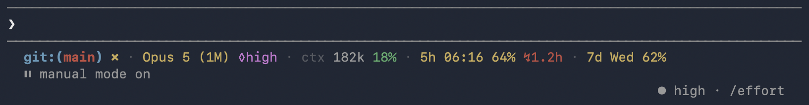

# budget-statusline

One line under the Claude Code prompt: your usage budget for any account, and when it runs out at this pace.

[](https://github.com/dima-gusyatiner/budget-statusline/actions/workflows/tests.yml) [](LICENSE)

<p align="center">
  <picture>
    <source media="(prefers-color-scheme: dark)" srcset="docs/images/hero-dark.png">
    <source media="(prefers-color-scheme: light)" srcset="docs/images/hero-light.png">
    
  </picture>
</p>

<details>
<summary>The line as text</summary>

```text
git:(main) ✗ · Opus 5 (1M) ◊high · ctx 182k 18% · 5h 06:16 64% ↯1.2h · 7d Wed 62%
```

</details>

## Install

```sh
claude plugin marketplace add dima-gusyatiner/budget-statusline
claude plugin install budget-statusline@budget-statusline
```

Then start a new session. The plugin copies its two scripts into your config folder, `~/.claude`, and points `statusLine` in `settings.json` at `statusline.sh`, unless you already have a `statusLine`. It leaves yours alone and says so once in Claude Code, with the line to use instead.

Claude Code leaves auto-update off for a marketplace added from GitHub. To get new versions by themselves, turn it on once: `/plugin`, Marketplaces, `budget-statusline`, Enable auto-update. If `DISABLE_UPDATES`, `DISABLE_AUTOUPDATER` or `CLAUDE_CODE_DISABLE_NONESSENTIAL_TRAFFIC` is set, Claude Code turns plugin auto-update off and hides that toggle, unless `FORCE_AUTOUPDATE_PLUGINS=1` is set too ([when auto-update runs](https://code.claude.com/docs/en/plugins/loading#when-auto-update-runs)). An update arrives when the version number changes, not with every commit. Claude Code looks for it in the background, and the next session start loads it and copies the new scripts.

<details>
<summary>Turn on auto-update in <code>settings.json</code> instead</summary>

`marketplace add` already wrote an entry for the marketplace in `~/.claude/settings.json`. Add `"autoUpdate": true` to that entry rather than pasting a second copy:

```json
"extraKnownMarketplaces": {
  "budget-statusline": {
    "source": { "source": "github", "repo": "dima-gusyatiner/budget-statusline" },
    "autoUpdate": true
  }
}
```

</details>

<details>
<summary>Install without the plugin system</summary>

```sh
git clone https://github.com/dima-gusyatiner/budget-statusline.git
cd budget-statusline
sh install.sh --dry-run
sh install.sh
```

The folder is `--config-dir`, else `$CLAUDE_CONFIG_DIR`, else `~/.claude`. `--dry-run` says what would happen and changes nothing. The installer never overwrites a file it did not install or one you edited, updates neither script while you have edited either, since the two must be the same version, and touches `settings.json` only when it has no `statusLine` yet. Without `jq` it leaves `settings.json` alone and prints the line to add. To update, `git pull` and run it again.

To set it all up by hand: [configuration](docs/configuration.md).

</details>

### Requirements

- Claude Code 2.1.251 or newer. Older versions still draw a line, with fewer parts.
- `jq`. Recent macOS includes it; elsewhere `brew install jq`, `apt install jq` or `winget install jqlang.jq`.
- `curl` 7.55 or newer, for the Enterprise cap and usage credits only.
- `git`, optional.
- macOS, Linux, or Windows with Git Bash: [Windows](docs/windows.md).

Tested by hand on Claude Code 2.1.292 on macOS 26. Both test suites run on Linux, macOS and Windows for every pull request.

## What the line says

`↯1.2h` in the picture is the burn estimate: at the recent pace, that window is full in 1.2 hours. Colour carries the severity: **green** under 50%, **yellow** from 50%, **red** from 80%. A word in place of a figure, such as `cap login`, says why there is none ([troubleshooting](#troubleshooting)). On a narrow terminal the line drops detail in steps, budget last ([narrow terminals](docs/narrow-terminals.md)). Every part, symbol and state: [what the line shows](docs/accounts.md).

The budget part depends on your account, and picks itself:

| Account | You see | Where it comes from |
|---|---|---|
| Claude Pro or Max | `5h 06:16 64% · 7d Wed 62%` | Claude Code passes both windows in |
| Pro or Max, a window full | adds `¤$12.40` | the usage endpoint, [below](#what-it-reads-writes-and-sends) |
| Enterprise usage-based seat | `cap 01/Nov 80%` | the usage endpoint |
| Claude apps gateway with a spend limit | `cap 23/Oct 78%` | Claude Code passes it in |
| API key, Amazon Bedrock, Google Vertex AI | `$2.50`, or `$42.60/50 85%` | this session's cost, summed on your machine |

[How it decides](docs/how-it-works.md).

## What it reads, writes and sends

| | What | When |
|---|---|---|
| Reads | The JSON Claude Code passes the status line, the `git` branch and status of your working folder, and two strings in Claude Code's `.claude.json` | Every update of the line |
| Reads | Your Claude sign-in token, from the macOS keychain or `.credentials.json` | Enterprise usage-based seat, or a full Pro or Max window |
| Sends | That token to `https://api.anthropic.com/api/oauth/usage` over HTTPS, and nowhere else | The same two cases, at most once every 5 minutes |
| Writes | Small state files with figures and times. The token is never stored or logged | In the config folder, as the line updates |
| Writes | The two scripts and a manifest, the plugin's log and its last message, and a `statusLine` in `settings.json` only when there is none | At session start (plugin), or when you run `install.sh` |

`usage-refresh.sh` identifies itself as Claude Code (`User-Agent: claude-code/<version>`), because the endpoint has throttled requests without that. The endpoint is undocumented and may change or go away; the line then shows the reason, such as `cap api moved`, rather than a wrong number. Anthropic's terms restrict third-party use of Claude.ai credentials: read the [legal and compliance page](https://code.claude.com/docs/en/legal-and-compliance) and decide. To switch the endpoint off, put `CC_ENTERPRISE=0 CC_CREDITS=0` in front of the command already in your `settings.json`, keeping its path, as in `CC_ENTERPRISE=0 CC_CREDITS=0 ~/.claude/statusline.sh`. Then the line reads no token and makes no network call, and an Enterprise seat shows the local dollar estimate. Details: [the usage endpoint](docs/usage-endpoint.md) and [SECURITY.md](SECURITY.md).

## Configuration

Settings are environment variables you put in front of the command already in `settings.json`, keeping its path: `CC_ASCII=1 ~/.claude/statusline.sh` in the default folder.

| Variable | Effect |
|---|---|
| `CC_ASCII` | `1` draws a pure ASCII line, `0` never does. Unset, ASCII turns on by itself on the Linux text console, in a locale that is not UTF-8 and in the classic Windows console |
| `CC_WIDTH` | The width to fit the line to. Unset, the terminal width minus 4; `0` turns the fitting off |
| `CC_CREDITS` | `0` turns off the usage credits lookup |
| `CC_ENTERPRISE` | `1` forces the Enterprise monthly cap on, `0` off. Unset, it is detected |
| `CC_SPEND_DOLLARS` | `1` adds the dollars to the Enterprise cap: `cap 01/Nov $160.40/200 80%` |
| `CC_USAGE_FLOOR` | Seconds between Enterprise refreshes below 50% of the cap. Default `1800`, at least `300` |
| `CC_SPEND_CAP` | A dollar cap for the local estimate: `CC_SPEND_CAP=50` draws `$42.60/50 85%` |
| `CC_SPEND_PERIOD` | `day`, `week` or `month`, the default: the period the local estimate covers |

Every value, the config folder and the state files: [configuration](docs/configuration.md).

## Troubleshooting

| You see | What to do |
|---|---|
| No line after installing | Start a new session. When the plugin cannot wire `settings.json`, it says so once in Claude Code, with the line to add; `~/.claude/.budget-statusline.log` keeps the details. A managed `allowManagedHooksOnly` or `disableAllHooks` setting blocks the plugin and the status line alike |
| Your old status line is still there | The plugin never replaces one, and says so once. Set its `command` to the `statusline.sh` in your config folder: `~/.claude/statusline.sh`, or its full path under `CLAUDE_CONFIG_DIR` |
| An update changed nothing | You edited one of the two scripts, so the plugin updates neither: they must be the same version. It says once which file, and the log keeps it. Undo the edit, or delete the file, and start a new session |
| `statusline: jq not installed` | Install `jq` |
| `cap login` or `¤login`, yellow | No login found, or the token was refused: run `/login`. The line tries again after 5 minutes, sending only a new token; after 60 minutes when there was no login or the token has no expiry |
| `cap tls`, yellow | `curl` does not trust the certificate it gets, usually from a company proxy that re-signs HTTPS. Make `curl` trust that proxy's certificate |
| `cap no refresher`, yellow | `usage-refresh.sh` is missing or not executable. Start a new session: the plugin puts it back, or gives it back the execute bit it lost. Without the plugin, run `install.sh` again |
| `cap login`, dim | The token expired. Claude Code renews it, and the line looks again 2 minutes later |
| `cap throttled` | Too many requests. The line backs off, at most an hour between tries, and needs nothing from you |
| `cap api moved`, red | The endpoint changed. Update, or [open an issue](https://github.com/dima-gusyatiner/budget-statusline/issues/new/choose) |
| Boxes, or symbols over the next character | Your font lacks a symbol: set `CC_ASCII=1` |
| A folder name instead of the branch | Either a detached HEAD, which has no branch to show, or a repository that belongs to another account, which git will not read. If you trust that one: `git config --global --add safe.directory <path>` |
| The end of the line cut off | With a `statusLine` `padding` of 2, set `CC_WIDTH=-8` |

All the reasons the line can show: [when it cannot get a number](docs/usage-endpoint.md#when-it-cannot-get-a-number).

## Update and uninstall

To update by hand:

```sh
claude plugin marketplace update budget-statusline
claude plugin update budget-statusline@budget-statusline
```

Then start a new session.

To uninstall, first remove what the plugin copied, with the installer it brought along, then the plugin:

```sh
sh ~/.claude/plugins/marketplaces/budget-statusline/install.sh --uninstall
claude plugin uninstall budget-statusline@budget-statusline
```

With `CLAUDE_CONFIG_DIR` set, the first line is `sh "$CLAUDE_CONFIG_DIR/plugins/marketplaces/budget-statusline/install.sh" --uninstall`; with `CLAUDE_CODE_PLUGIN_CACHE_DIR` set, the folder is `marketplaces/budget-statusline` under it. If you added the marketplace from a local folder, Claude Code keeps no copy, so run `sh install.sh --uninstall` in that folder. The installer removes only what the plugin placed and you have not edited, and the `statusLine` with the script it runs; `--dry-run` shows what it would do. If you edited `statusline.sh`, it keeps the file and the `statusLine` that runs it, and says so: delete the file and run the uninstall again to remove both. Removing only the plugin would leave the copied scripts, one of which can read your sign-in token, wired into `settings.json`. To drop the marketplace too: `claude plugin marketplace remove budget-statusline`.

Installed with the script? Run `sh install.sh --uninstall` in your clone.

## Support

- Best effort: this is a one-person project with no promised response time. Bugs go in the [bug form](https://github.com/dima-gusyatiner/budget-statusline/issues/new/choose).
- Feature requests are welcome and may be declined: the line stays one line, and the scripts stay plain `sh`.
- Security problems: report them privately, as [SECURITY.md](SECURITY.md) says.

## More

- [What the line shows](docs/accounts.md): every part, every account, the ASCII forms
- [How it works](docs/how-it-works.md): which budget is drawn, several sessions, the burn estimate
- [The usage endpoint](docs/usage-endpoint.md): when it is called, what it sends, what each failure means
- [Configuration](docs/configuration.md), [narrow terminals](docs/narrow-terminals.md), [Windows](docs/windows.md), [limits](docs/limits.md)
- [Contributing](CONTRIBUTING.md), [changelog](CHANGELOG.md), [security](SECURITY.md)

MIT licence, see [LICENSE](LICENSE). An independent project, not made or endorsed by Anthropic.
