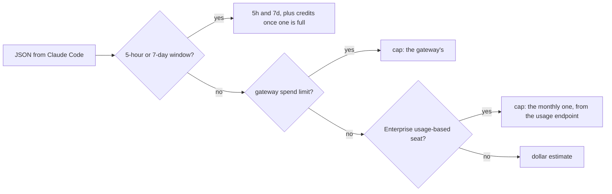

# How it works

`statusline.sh` runs each time Claude Code updates the status line. It reads the JSON Claude Code pipes in, prints one line and exits. It keeps a few small files in the [config folder](configuration.md#the-config-folder), and starts `usage-refresh.sh` in the background when it needs a figure the JSON does not carry. None of this needs setting up.

## Which budget is drawn

The same in words, for places that do not draw the diagram:

1. The JSON has a 5-hour or 7-day window: Pro or Max. Each window it has is drawn, and [usage credits](accounts.md#usage-credits) are added while one of them is full.
2. The JSON has a gateway spend limit: drawn as `cap`. A JSON with plan windows and a spend limit draws both, but never usage credits: behind a gateway the gateway sets the budget, and the refresher, which reads the login, does not run.
3. Neither, on an Enterprise usage-based seat: the monthly cap, from the [usage endpoint](usage-endpoint.md).
4. None of these: the local dollar estimate, unless this machine has shown plan windows in the last 8 days (see [the first render of a new chat](#the-first-render-of-a-new-chat)).

## Spotting an Enterprise seat

With `CC_ENTERPRISE` unset, the line looks for the string `enterprise_usage_based` in Claude Code's own `.claude.json`, with a single `grep`. That file sits in `CLAUDE_CONFIG_DIR` when it is set and in your home folder otherwise; a `.config.json` in the config folder, the name older Claude Code versions used, takes its place.

Once a fetch has left `.usage-cache.json` in the config folder, the machine stays on the Enterprise path while that file is under 8 days old, even if the string moves. That is the latch; while it holds, the `grep` does not run. A machine that has shown 5-hour or 7-day windows in the last 8 days is never taken for an Enterprise seat, whatever either file says: an Enterprise usage-based seat never gets plan windows, so such a machine has moved to Pro or Max. Delete `.usage-cache.json` to release the latch at once.

The care is there for one case: a machine that moved from an Enterprise seat to an API key, with the old login still stored, would otherwise send that token to the usage endpoint for good. After 8 days without a fresh snapshot it shows the dollar estimate, unless its `.claude.json` still names the seat.

`CC_ENTERPRISE=1` forces the Enterprise path on, `CC_ENTERPRISE=0` forces it off, and either skips the `grep`.

## The first render of a new chat

Claude Code passes the plan windows "only after the first API response in the session", in the words of its [status line documentation](https://code.claude.com/docs/en/statusline). So the first render of a new chat on a Pro or Max seat has no windows, and would fall through to the dollar estimate. To keep dollars off a seat that does not pay per token, the dollar estimate stays hidden for 8 days after the line last saw plan windows on this machine. Past that, the seat is taken to have changed.

## Several sessions

A session only hears the replies to its own requests, so one left idle keeps the figure it heard last. To keep sessions in agreement, the line keeps one record per window in the config folder, `.rl-<key>-state`, shared by every session of the login. The keys are `5h`, `7d`, `gateway`, `spend` (the Enterprise cap), `credits` and `ledger`.

- The record keeps the highest figure any session has shown in the window. Within a window usage only goes up, so a lower figure is an older reading.
- A session whose own figure is lower draws the record's, as long as some session has shown it in the last 30 minutes. A tab left open on 45% shows the 62% another one has seen.
- A window is known by its reset time. A reset time more than 10 minutes later starts a new record.
- A session left idle past its window's reset draws the newer window from the record, its figure and its reset time, once another session has seen it. Until then the window reads a dim `5h reset` (or `7d reset`, `cap reset`), with no old figure and no burn estimate, until a reply brings the new one. While its own window still runs, a session keeps its own figure.
- The Enterprise snapshot and the credits figures are read by every session from one file, so a lower figure there is the server's newer word and is drawn at once.

## The burn estimate

`↯1.2h` means that at the recent pace, the window reaches 100% in 1.2 hours. Under an hour the estimate counts minutes, `m`, instead of hours, `h`.

- The pace is a moving average of the window's rises. Each rise counts in full when it comes, then fades: over about 30 minutes on the 5-hour window, and over a day on the others.
- It belongs to the window, so it is never restarted while the window lasts and does not go blank between replies.
- It shows from 50% on the 5-hour window and from 70% on the others, and never at 100%.
- A new record waits 7 minutes before it shows an estimate. In the first 2 minutes every open session draws, and their catching up is not a burst.
- It is red when 100% would come before the window resets, and dim otherwise. The dollar estimate has no reset, so its `↯` is never red.

The minutes are rough, because usage comes in bursts. The colour is the part to act on.

## The dollar estimate

On a pay-per-token account Claude Code passes only this session's estimated cost at list price, `cost.total_cost_usd`. The line keeps one entry per session and period in `.spend-ledger`, so the total adds up several sessions. `CC_SPEND_PERIOD` picks the period: `day`, `week` or `month`, the default.

It counts only sessions whose status line ran, so `claude -p` runs and other machines are missing. It is an estimate on your machine, not your bill: the Claude Console or your cloud console has the real figure.

`CC_SPEND_CAP=50` turns it into a share of a 50-dollar cap: `$42.60/50 85%`.

## Width

The line fits itself to the terminal and drops detail in steps, budget last: [narrow terminals](narrow-terminals.md).
