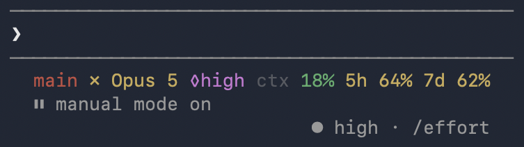

# Narrow terminals

A line wider than the terminal gets cut at its end, and the end is the budget. So the line fits itself to the terminal: it gives up detail in steps and draws the widest form that fits. The budget is the last thing to go, and it never goes entirely.

<p align="center">
  
</p>

The forms, with the columns each one takes. Each is drawn from that width up to one column below the form above it:

```text
81  git:(main) ✗ · Opus 5 (1M) ◊high · ctx 182k 18% · 5h 06:16 64% ↯1.2h · 7d Wed 62%
75  main ✗ · Opus 5 (1M) ◊high · ctx 182k 18% · 5h 06:16 64% ↯1.2h · 7d Wed 62%
67  main ✗ Opus 5 (1M) ◊high ctx 182k 18% 5h 06:16 64% ↯1.2h 7d Wed 62%
57  main ✗ Opus 5 ◊high ctx 18% 5h 06:16 64% ↯1.2h 7d Wed 62%
41  main ✗ Opus 5 ◊high ctx 18% 5h 64% 7d 62%
28  main ✗ ctx 18% 5h 64% 7d 62%
21  ctx 18% 5h 64% 7d 62%
13  5h 64% 7d 62%
```

| Step | Gives up |
|---|---|
| 1 | `git:( )` around the branch |
| 2 | The dots between groups |
| 3 | `(1M)` after the model, and the token count |
| 4 | The branch's type, such as `feat/`. A name still over 13 characters is cut to 12 and `…`. A short branch like `main` loses nothing here, so the example skips it |
| 5 | Reset times, the burn estimate, and dollars shown next to a percentage |
| 6 | The model and the effort |
| 7 | The branch |
| 8 | The context |

A long branch on a clean tree, at 50 columns, and the same with `CC_ASCII=1`:

```text
a-long-branc… ✓ Opus 5 ◊high ctx 18% 5h 64% 7d 62%
a-long-bran.. Opus 5 high ctx 18% 5h 64% 7d 62%
```

The ASCII forms shrink the same way. At 41 columns: `main * Opus 5 high ctx 18% 5h 64% 7d 62%`. The dollar estimate against a cap keeps its share to the end: `cap 85%` at 8 columns.

## The width

Claude Code passes its terminal width to the command as `COLUMNS`. The status line box keeps 2 columns of padding on each side, so the line gets `COLUMNS - 4`. Measured on Claude Code 2.1.287: a line of exactly that width shows whole, and one more character gets the end cut to `…`.

A resize does not run the command again. Claude Code cuts the old line to the new width at once, and the next run fits it properly. That run comes with the next message, or at the next `refreshInterval` tick; the plugin and `install.sh` set 60 seconds.

`CC_WIDTH` in the command changes the rule:

| `CC_WIDTH` | Width used |
|---|---|
| unset | `COLUMNS - 4` |
| `-8` | `COLUMNS - 8`, for a `statusLine` `padding` of 2, which takes 2 more columns on each side |
| `60` | 60, whatever the terminal |
| `0` | no fitting, always the full line |

Without `COLUMNS`, as when the script is run by hand, the full line is drawn unless `CC_WIDTH` names a width.

## Limits

- Every symbol counts as one column. A terminal set to draw ambiguous-width characters two columns wide, as some East Asian setups are, cuts the line early. `CC_ASCII=1` avoids that.
- A long branch or folder name with characters outside plain ASCII is shortened only by a shell that counts characters, which is `bash` in a UTF-8 locale. Under `dash`, or in the C locale, it stays whole rather than risk splitting a character. Plain ASCII names are shortened by every shell.
- Chinese, Japanese and Korean characters take two columns but count as one, so a name made of them can still push the end of the line, the budget, past the edge.
