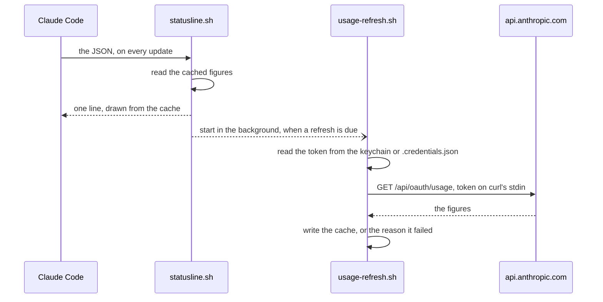

# The usage endpoint

Two figures on the line are not in the JSON Claude Code passes a status line: the monthly cap of an Enterprise usage-based seat, and usage credits once a Pro or Max window is full. For those two, and nothing else, `usage-refresh.sh` asks an undocumented Anthropic endpoint, `GET https://api.anthropic.com/api/oauth/usage`, with your Claude sign-in token. Behind a Claude apps gateway it never runs, and with an API key only when [something marks the machine as an Enterprise seat](how-it-works.md#spotting-an-enterprise-seat).



The line is always drawn from the cache, so a slow or failed call never holds it up.

## Why the JSON is not enough

- **Enterprise usage-based seat.** The JSON has no `rate_limits` key at all. Claude Code's [status line documentation](https://code.claude.com/docs/en/statusline) says `rate_limits` "appears only for claude.ai Pro and Max subscribers, or behind a Claude apps gateway that sets a spend limit". Seen on Claude Code 2.1.252, and reported by others since ([anthropics/claude-code#96543](https://github.com/anthropics/claude-code/issues/96543)). The endpoint's own reply has the 5-hour and 7-day windows empty for this seat; the only limit is a monthly spend cap.
- **The session cost is no substitute.** `cost.total_cost_usd` is this session's cost, estimated at list price. Measured next to the account's real total, one session's figure came out larger than the account-wide one. It carries no limit and no reset date either.
- **Claude Code's cached copy is too old.** Claude Code keeps a copy of the figures in its `.claude.json`, but refreshes it rarely: one copy was seen 6 days old, still showing 100% of a cap that had since reset. The line does not read it.
- **Usage credits.** The JSON has no field for them at all.

## What it does with your login

1. **It reads the token Claude Code stored for this config folder.** Claude Code keeps one login per config folder, in the macOS keychain or in `.credentials.json` (see "Credential management" in [authentication](https://code.claude.com/docs/en/authentication)). On macOS the refresher reads the keychain item with `security find-generic-password` for your account, `$USER`, and falls back to the same item under any account. As observed on Claude Code 2.1.292, the item is `Claude Code-credentials`, and with `CLAUDE_CONFIG_DIR` set, that name plus `-` and the first 8 hex digits of the SHA-256 of the variable exactly as set, so a second login never reads the first one's token. Elsewhere, or when the keychain has nothing, it reads `.credentials.json` in the [config folder](configuration.md#the-config-folder). The keychain hands over the whole credentials record, refresh token included. `jq` keeps two fields, the access token and its expiry, and drops the rest. The token is never written to disk or logged.
2. **An expired or refused token is never sent.** For an expired token the refresher stops there: Claude Code renews it on its next request, and the line looks again 2 minutes later. The endpoint has answered an expired token with a 429 and `Retry-After: 3117`, close to an hour ([vinzdg/codenotch#192](https://github.com/vinzdg/codenotch/pull/192)), which would otherwise read as an hour of throttling. When the endpoint refuses a token (HTTP 401 or 403), the refresher keeps that token's expiry time as a fingerprint and does not send the same token again. A new `/login` brings a new token, and the line tries it within 5 minutes.
3. **It sends one request.** `GET https://api.anthropic.com/api/oauth/usage` with `Authorization: Bearer <token>`, `anthropic-beta: oauth-2025-04-20`, `Content-Type: application/json` and `User-Agent: claude-code/<version>`, the Claude Code version from the JSON. Requests without a Claude Code user agent have been throttled ([anthropics/claude-code#30930](https://github.com/anthropics/claude-code/issues/30930)). The token goes to `curl` on standard input, never on the command line, so other accounts on the machine cannot read it from the process list. That is the only host it talks to, over HTTPS. `curl` runs with `-q`, so a `~/.curlrc` of yours never applies to this call; it follows no redirects, takes at most 1 MiB of reply, and gives up after 10 seconds.
4. **It keeps a few figures.** For the Enterprise cap, `.usage-cache.json`, about 120 bytes: the share used, the amount spent, the limit, the severity, when it was fetched, and the local spend total at that moment. For usage credits, `.credits-cache.json`: whether credits are on, the amount spent, the monthly limit, the share, the currency, the reset date and this session's spend at that moment. The raw reply sits in a temporary file that is deleted when the refresher exits. Everything the refresher writes is readable by your account only, mode 600.

The share is the amount spent divided by the limit when the reply has both, because the reply's own `spend.percent` is rounded to a whole number (a public test fixture in `vinzdg/codenotch` has `1` for 297 of 20000). Without the amounts it is `spend.percent`. Some organisations get no figure in any of these fields ([anthropics/claude-code#84443](https://github.com/anthropics/claude-code/issues/84443)), and then the line says `cap no figure`.

## When it calls

Never twice within 5 minutes, whatever asks. The Enterprise cap and the credits share that clock.

### The Enterprise cap

Spend is the trigger, and the clock is only a backstop for spend that happened on another machine. Each render adds this session's cost to a running local total, `.usage-activity`, which only goes up, so a finished session or `/clear` cannot walk it back. Each snapshot records that total, so the spend since the last fetch is a subtraction.

| Condition | Refresh |
|---|---|
| Local spend since the last fetch is at least 0.25% of the limit | yes |
| Snapshot older than the floor, below 50% used | after 30 minutes (`CC_USAGE_FLOOR`, default 1800 seconds) |
| Snapshot older than the floor, 50% to 79% used | after 10 minutes |
| Snapshot older than the floor, 80% or more used | after 5 minutes |
| Within 5 minutes of the last call | never |
| The last call failed | after the wait for its reason, below |

One displayed point is 1% of the limit, so a 0.25% threshold cannot miss a visible change. An idle session settles at about two calls an hour below 50% of the cap, six from 50% and twelve from 80%. The figure is never extrapolated from local cost between fetches: that would be a guess.

### Usage credits

Only while a 5-hour or 7-day window is full. Then the refresher asks when there is no figure yet; when the figure is 5 minutes old and either this session has spent since or the last figure was fetched for another session; and when it is 30 minutes old, for spend elsewhere. So two sessions drawing at once keep the figure about 5 minutes fresh, even while idle. If the reply says the account has credits off, it asks once an hour. If Claude Code has recorded in its `.claude.json` why credits cannot be used (`cachedExtraUsageDisabledReason`, for example `org_level_disabled` or `out_of_credits`), it does not ask at all.

## When it cannot get a number

The line never draws a figure it cannot vouch for, and never hides why a refresh failed.

- A failure recorded after the figure on screen was fetched shows beside that figure, in every form down to the narrowest: `cap 01/Nov 42% login`, or `cap 42% login` on a narrow terminal. A failure from before the figure was fetched is not shown.
- Past three times the current floor the figure is dropped, and the reason takes its place on its own: `cap login`.
- With no figure at all, the reason shows at once. While the first fetch is on its way, and nothing has failed, a dim `cap …` holds the place.

The colour says who has to act: dim means there is nothing for you to do, yellow means you fix it, red means the server said no or changed its reply.

| Shown | Means | Tries again after |
|---|---|---|
| `offline`, dim | The request never reached the host | 5 minutes |
| `login`, dim | The stored token has expired. It is not sent: Claude Code renews it on its next request | 2 minutes |
| `login`, yellow | The token was refused (HTTP 401 or 403), or no login was found: run `/login` | 5 minutes, sending only a new token; 60 minutes when there is no login or the token has no expiry |
| `no curl`, yellow | `curl` is not installed, so no call can go out | 60 minutes |
| `no refresher`, yellow | `usage-refresh.sh` is missing or not executable, both next to `statusline.sh` and in the config folder. At the next session start the plugin puts it back, or restores its execute bit; `install.sh` does the same | 5 minutes |
| `tls`, yellow | `curl` refused the endpoint's certificate or the TLS handshake failed. The usual cause is a company proxy that re-signs HTTPS with a certificate `curl` does not trust, even when Claude Code does | 60 minutes |
| `throttled`, dim | HTTP 429, too many requests | see [throttling](#throttling) |
| `http 500`, red | The server refused for another reason, with its status code | 10 minutes |
| `api moved`, red | HTTP 200, but the reply has a shape the line does not know, or is over 1 MiB | 60 minutes |
| `no figure`, dim | HTTP 200, a usage reply, but no spend figure for this seat | 60 minutes |
| `stale 6d`, dim | The figure is too old to draw, and no failure was recorded | as soon as the 5-minute gap allows |

On an Enterprise seat each reason follows `cap `, as in `cap tls`. Usage credits show the same reasons after `¤`: `¤login`, `¤tls`, `¤no refresher`, or `¤$12.50 login` beside a figure. The ASCII line uses `+`. The last reason, with the time it was recorded, is kept in `.usage-unavailable`, or `.credits-unavailable` for credits, in the config folder.

## Throttling

After an HTTP 429 the refresher keeps away for the longer of what the server asks in `Retry-After` and 5 minutes, doubled for each further 429 in a row, at most an hour. A 429 is the server asking for quiet, not a broken figure, so the last figure stays on the line for at least an hour, or three floors if that is longer, with its age and the word: `cap 01/Nov 91%…20m throttled`. Only then does it give way to `cap throttled` alone.

Anthropic publishes no limit for this endpoint. Reports point at several sessions polling one account ([anthropics/claude-code#77477](https://github.com/anthropics/claude-code/issues/77477)), and at retries during a refusal stretching it ([jarrodwatts/claude-hud#275](https://github.com/jarrodwatts/claude-hud/issues/275)). As of October 2026 the main threads ([#30930](https://github.com/anthropics/claude-code/issues/30930), [#31021](https://github.com/anthropics/claude-code/issues/31021), [#31637](https://github.com/anthropics/claude-code/issues/31637)) had no answer from Anthropic. So there is one refresher per login, shared by every session, and at most one call every 5 minutes. For comparison, `ccstatusline` waits 300 seconds after a 429 that names no wait.

## Reset dates

The reply has no reset date for the monthly cap, so the line uses the next UTC month boundary. That follows a checked value: a 429 from the server carried `resetsAt` of exactly `2026-09-01T00:00Z`, the first of the month in UTC. In a time zone behind UTC the stamp lands on the last day of the month, which is right locally.

Usage credits have no reset date in the reply either. The line takes the first of next month, local time.

A figure from before the month started over is last month's, however young. The line does not draw it: it asks for a new one at once, and says `cap stale` with the figure's age, or the reason, until the new one comes. A credits figure past its reset date reads `¤credits` until then.

## Anthropic's terms

Anthropic's [legal and compliance page](https://code.claude.com/docs/en/legal-and-compliance) says OAuth authentication is meant for "ordinary use of Claude Code and other native Anthropic applications", and that "developers may not collect, store, or intermediate Claude.ai credentials or session tokens". The refresher reads your token on your own machine and sends it only to Anthropic, but it is a third-party tool doing so, and it identifies itself as Claude Code. Read the page and decide. If in doubt, switch it off.

## Switching it off

Put both variables in front of the `statusLine` command already in your `settings.json`, and keep its path. In the default folder the command then reads:

```json
"command": "CC_ENTERPRISE=0 CC_CREDITS=0 ~/.claude/statusline.sh"
```

Under `CLAUDE_CONFIG_DIR` the command names the script by its full path; keep that path, or the status line goes blank. With both at `0` the line reads no keychain item and no credentials file, and makes no network call. An Enterprise seat then shows the local dollar estimate instead of the monthly cap, and a full window shows nothing about credits. Deleting `usage-refresh.sh` is not a way to switch it off: the line then says `cap no refresher`, and the plugin puts the file back at the next session start.
